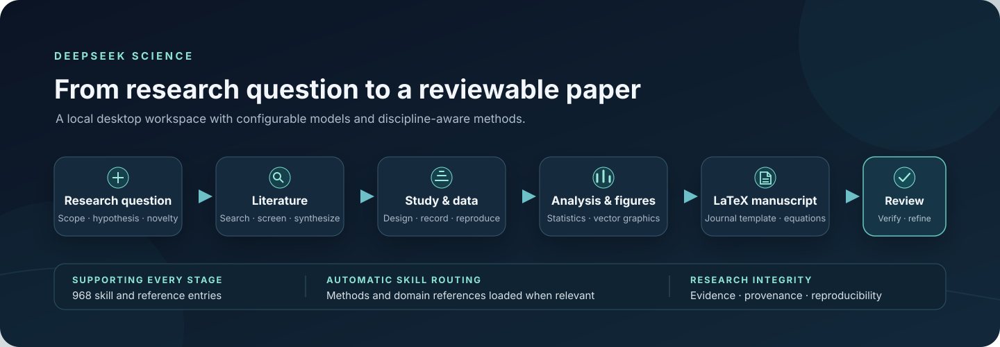
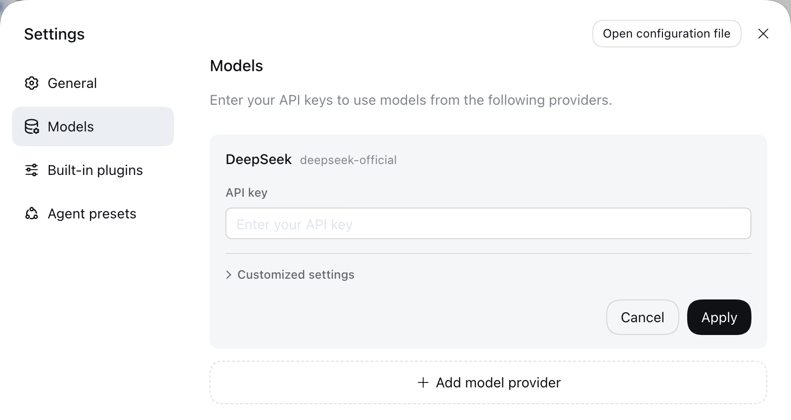

# DeepSeek Science

English | [中文](README.zh.md)

**A standalone, local-first AI research workbench for Windows.** DeepSeek Science combines the DeepSeek Harness desktop runtime with domain-aware research workflows, a built-in scientific skills library, and editable LaTeX and figure outputs.

[Download Windows setup](https://github.com/CZX-LBJ/deepseek-science/releases/download/v0.2.1-alpha.2/DeepSeek-Science-Setup-0.2.1-alpha.2.exe) · [All releases](https://github.com/CZX-LBJ/deepseek-science/releases) · [Report a bug](https://github.com/CZX-LBJ/deepseek-science/issues)



> DeepSeek Science is an independent community project. It is not an official DeepSeek, Anthropic, or OpenScience product.

<a id="run"></a>

## Install

1. Download [**DeepSeek Science Setup for Windows x64**](https://github.com/CZX-LBJ/deepseek-science/releases/download/v0.2.1-alpha.2/DeepSeek-Science-Setup-0.2.1-alpha.2.exe).
2. Run the Windows x64 installer and follow the setup prompts.
3. Open the app, go to **Settings → Models**, and add a provider and model.
4. Start a research workspace and describe the question in your own words.

The installer bundles the application runtime and built-in skills; Node.js and Python are not required for ordinary use. DeepSeek is available as a provider, and custom OpenAI-compatible endpoints can be configured in the same model settings page. You supply your own provider credentials and pay any provider charges directly.

<p align="center">
  
</p>

<p align="center"><em>Model credentials are entered by each user in their own app settings. The published build contains no API key.</em></p>

## What it can do

- **Move from a question to a paper.** Discover ideas, search and organize literature, plan experiments, analyze data, draft and review a manuscript, and prepare supporting files in one desktop workspace.
- **Choose research methods automatically.** A task router selects relevant built-in workflows and domain references as the conversation develops. Skills are available to the agent as guidance; users do not need to know skill names or invoke commands.
- **Work across disciplines.** Bundled materials cover AI and computer science, biology, medicine, chemistry, physics, mathematics, engineering, electronics, statistics, and scientific communication.
- **Prepare scientific figures.** The scientific plotting workflow favors reproducible Python code and editable vector outputs, with clear panel structure, units, uncertainty, statistical annotations, and journal-aware sizing.
- **Write and compile in LaTeX.** Produce structured manuscripts with equations, references, tables, and figures. Two-column layouts and top- or bottom-aligned full-width floats are supported through the selected journal or conference template. Local PDF compilation requires a separately installed TeX distribution such as MiKTeX or TeX Live.
- **Use the model you choose.** Configure DeepSeek or a compatible custom provider and select the model in the desktop app.

The built-in catalogue contains **968 verified skill and reference entries**. It includes the pinned Nature Skills collection (22 callable skills plus shared resources) and integrations from 19 attributed source projects. The academic-research-skills and academic-research-skills-codex packs are kept separately, disabled by default, and subject to their CC BY-NC 4.0 terms.

These counts describe bundled materials, rather than completed executable adaptations of every upstream workflow. See the [complete inventory and readiness details](docs/science-skills.md).

<p align="center">
  
</p>

## Research integrity

DeepSeek Science helps with research work; it does not establish that a result is true, novel, clinically validated, or ready for publication. Verify important claims against primary sources, check citations and analyses, and review generated code and figures. Do not let the agent invent data, methods, approvals, or references. Human researchers remain responsible for study design, ethics, interpretation, and submission.

The app sends prompts and files to the model provider and external tools you choose when a workflow requires them. Review the selected provider's privacy terms before sending sensitive or regulated data. The installer and public source repository contain no user API keys, chat history, research workspace, or local configuration.

## Source projects and licenses

DeepSeek Science builds on the MIT-licensed DeepSeek Harness.

See the [complete scientific skills inventory](docs/science-skills.md) for source counts, discovery defaults, and runtime requirements. Bundled materials include:

- Research and writing: [OpenScience](https://github.com/synthetic-sciences/openscience), [Nature Skills](https://github.com/Yuan1z0825/nature-skills), [Claude Scholar](https://github.com/Galaxy-Dawn/claude-scholar), [AI Research Skills](https://github.com/Orchestra-Research/AI-Research-SKILLs), [ARIS](https://github.com/wanshuiyin/Auto-claude-code-research-in-sleep), [Academic Research Skills](https://github.com/Imbad0202/academic-research-skills), [Academic Research Skills Codex](https://github.com/Imbad0202/academic-research-skills-codex), [Scientific Agent Skills](https://github.com/K-Dense-AI/scientific-agent-skills), [Claude Scientific Writer](https://github.com/K-Dense-AI/claude-scientific-writer), [bioSkills](https://github.com/GPTomics/bioSkills).
- Software, models, and engineering: [Superpowers](https://github.com/obra/superpowers), [Matt Pocock Skills](https://github.com/mattpocock/skills), [Hugging Face Skills](https://github.com/huggingface/skills), [KiCad Happy](https://github.com/aklofas/kicad-happy), [Lean4 Skills](https://github.com/cameronfreer/lean4-skills).
- Reference guides: [SciPy guides](https://github.com/scipy/scipy), [SymPy guides](https://github.com/sympy/sympy), [python-control guides](https://github.com/python-control/python-control), [QuTiP tutorials](https://github.com/qutip/qutip-tutorials).

Each embedded source is pinned and attributed in [`packages/skill/skill-science/assets/NOTICE.md`](packages/skill/skill-science/assets/NOTICE.md); original license files are retained beside the corresponding materials. The root MIT license covers the Harness code and project-authored changes only. It does not replace third-party terms. In particular, materials under `assets/noncommercial/` remain CC BY-NC 4.0 and do not grant commercial-use rights.

<a id="run-from-source"></a>

## Build from source

The prebuilt Windows release is the recommended way to install the application. To build the source and run the scientific CLI profile, use Windows x64, Node.js 24, Git, and pnpm 11.7.0:

```powershell
corepack enable
corepack prepare pnpm@11.7.0 --activate
git clone -c core.longpaths=true https://github.com/CZX-LBJ/deepseek-science.git
Set-Location deepseek-science
pnpm install --frozen-lockfile
pnpm run build:official
pnpm run start:science
```

The standalone Science release uses [`science-portable.mjs`](apps/desktop/scripts/science-portable.mjs), which requires the compiled desktop/web outputs, a production deployment prepared with `node-linker=hoisted`, and a prepared primary runtime. Its `--deployment`, `--runtime`, and `--out` arguments select these directories; `--out` must be a new directory. This is an advanced packaging path, separate from the CLI development launch above. The inherited Harness packaging and CI workflows require additional upstream infrastructure and are not a one-command Science release pipeline.

The unsigned installer may trigger a Windows SmartScreen prompt. Release installers are published with a SHA-256 checksum. See the desktop packaging scripts and [contributing guide](CONTRIBUTING.md) before changing the release pipeline.

## Project references

The README and workflow presentation follow established open-source research-tool conventions: a clear quick start, task-based capability map, visible source attribution, and explicit installation and privacy notes. See [`NOTICE.md`](packages/skill/skill-science/assets/NOTICE.md) for pinned source revisions, attribution, and license terms.

## License

Harness code and DeepSeek Science changes are covered by the MIT License in [`LICENSE`](LICENSE), subject to the third-party terms described above and in the embedded resource directories.
