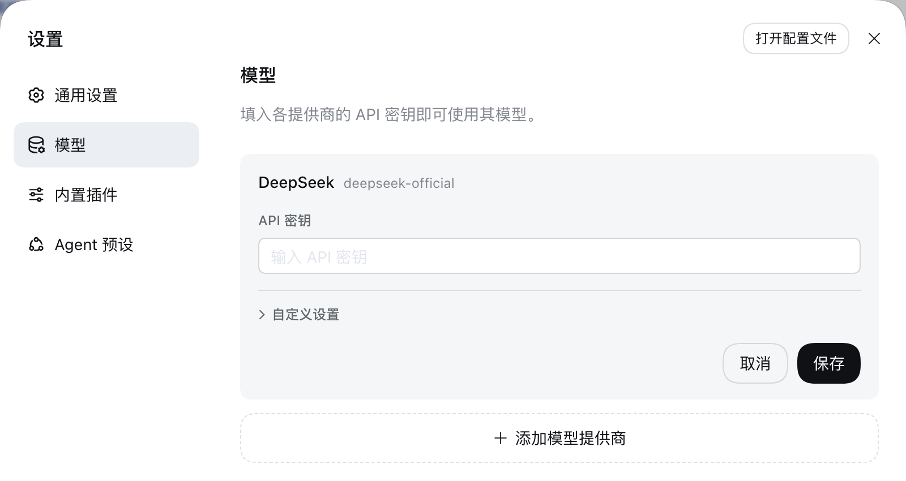
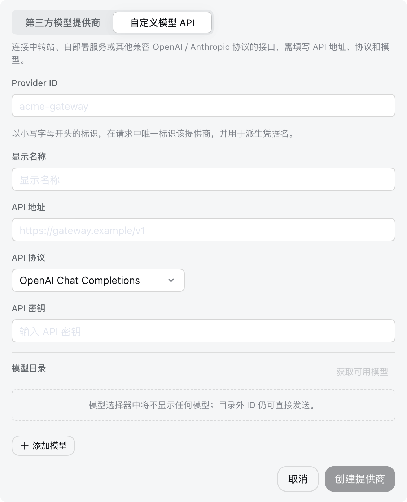

# DeepSeek Science

[English](README.md) | 中文

**面向 Windows 的独立 AI 科研工作台。** DeepSeek Science 以 DeepSeek Harness 桌面运行时为基础，整合跨学科科研流程、内置科研技能库，以及可编辑的 LaTeX 论文和学术图表工作流。

[下载 Windows 安装包](https://github.com/OWNER/deepseek-science/releases/download/v0.2.1-alpha.1/DeepSeek-Science-Setup-0.2.1-alpha.1.exe) · [全部版本](https://github.com/OWNER/deepseek-science/releases) · [反馈问题](https://github.com/OWNER/deepseek-science/issues)


> DeepSeek Science 是独立社区项目，与 DeepSeek、Anthropic、OpenScience 均无官方隶属或背书关系。

## 安装

1. 下载 [**DeepSeek Science Windows x64 安装包**](https://github.com/OWNER/deepseek-science/releases/download/v0.2.1-alpha.1/DeepSeek-Science-Setup-0.2.1-alpha.1.exe)。
2. 运行 Windows x64 安装包并按提示完成安装。
3. 打开应用，在 **设置 → 模型** 中添加模型提供商和模型。
4. 新建科研工作区，用自然语言描述你的研究问题。

安装包内含应用运行时和科研技能。日常使用不需要另外安装 Node.js 或 Python。你可以选择 DeepSeek，也可以在相同设置页面配置兼容 OpenAI API 的自定义模型。模型 API 密钥由你自行提供，费用由模型服务商收取。

<p align="center">
  
</p>

<p align="center"><em>每位用户在自己的应用设置中填写模型凭据；公开安装包不含 API 密钥。</em></p>

## 功能

- **从问题推进到论文：** 选题与新颖性分析、文献检索和整理、实验设计、数据分析、论文起草与审阅，以及配套材料准备。
- **按任务自动选择科研流程：** agent 会结合当前任务加载合适的科研技能和领域参考资料；用户无需记忆技能名称或手动输入技能命令。
- **覆盖多个科研领域：** AI 与计算机、生物、医学、化学、物理、数学、工程、电子、统计和科研写作等。
- **学术绘图：** 优先生成可复现的 Python 绘图代码和可编辑矢量图，关注分面结构、单位、不确定性、统计标注、期刊尺寸和图注。
- **LaTeX 论文排版：** 生成带公式、参考文献、表格和图件的结构化稿件；可按选定的期刊或会议模板处理双栏版式以及页顶、页底通栏图表。需要编译 PDF 时，请按目标模板安装 MiKTeX 或 TeX Live 等 TeX 发行版。
- **模型可自定义：** 在桌面应用中配置 DeepSeek 或兼容的自定义模型并选择实际使用的模型。

技能目录包含 **968 项经过校验的技能与参考资料**，其中集成了固定版本的 Nature Skills（22 个可调用技能及共享资源），并引用 19 个上游科研项目。`academic-research-skills` 与 `academic-research-skills-codex` 两个资源包单独存放且默认关闭；它们受 CC BY-NC 4.0 许可约束。

<p align="center">
  
</p>

## 科研诚信

DeepSeek Science 用于辅助科研工作，不能证明结果真实、新颖、临床有效或已达到投稿标准。请对照一手来源核查关键论断，检查引用、分析、代码和图表。不要让 agent 编造数据、方法、伦理审批或参考文献。研究设计、伦理、结果解释和投稿责任仍由研究者承担。

当工作流需要时，应用会把提示词和文件发送给你选定的模型服务商及外部工具。发送敏感或受监管数据前，请先查看对应服务的隐私条款。安装包和公开仓库不会包含用户 API 密钥、聊天记录、科研工作区或本地配置。

## 上游来源与许可

本项目基于 MIT 许可的 DeepSeek Harness，并参考或嵌入了 [OpenScience](https://github.com/synthetic-sciences/openscience)、[Nature Skills](https://github.com/Yuan1z0825/nature-skills)、[Claude Scholar](https://github.com/Galaxy-Dawn/claude-scholar)、[AI Research Skills](https://github.com/Orchestra-Research/AI-Research-SKILLs)、[ARIS](https://github.com/wanshuiyin/Auto-claude-code-research-in-sleep)、[Superpowers](https://github.com/obra/superpowers) 和 [Hugging Face Skills](https://github.com/huggingface/skills) 等项目的科研材料。

固定版本和归属信息见 [`packages/skill/skill-science/assets/NOTICE.md`](packages/skill/skill-science/assets/NOTICE.md)，原始许可文件保留在对应资源目录。根目录 MIT 许可只覆盖 Harness 代码和本项目编写的改动，不会替代第三方许可。特别是 `assets/noncommercial/` 下的材料继续受 CC BY-NC 4.0 约束，不授予商业使用权。

## 从源代码构建

普通用户建议安装预构建的 Windows 版本。开发需要 Windows x64、Node.js 22.19 或更新版本、Git 和 pnpm 11.7.0：

```powershell
corepack enable
corepack prepare pnpm@11.7.0 --activate
pnpm install --frozen-lockfile
$env:DSH_DESKTOP_APP_ID = "org.deepseek-science.desktop"
pnpm run build:official
pnpm --filter @deepseek-ai/dsh-desktop run package:win:x64:unsigned
```

未签名安装包可能触发 Windows SmartScreen 提示。Release 会同时提供 SHA-256 校验文件。修改打包流程前请阅读桌面端打包脚本和[贡献指南](CONTRIBUTING.zh.md)。

## 项目参考

科研流程和技能整合参考了 OpenScience、Nature Skills、Claude Scholar、AI Research Skills、ARIS、Superpowers 和 Hugging Face Skills 等开源项目。固定版本、归属和许可信息见 [`NOTICE.md`](packages/skill/skill-science/assets/NOTICE.md)。

## 许可

Harness 代码和 DeepSeek Science 改动采用根目录 [`LICENSE`](LICENSE) 中的 MIT 许可；第三方内容仍按上游许可使用，详情见上方说明和各资源目录。
